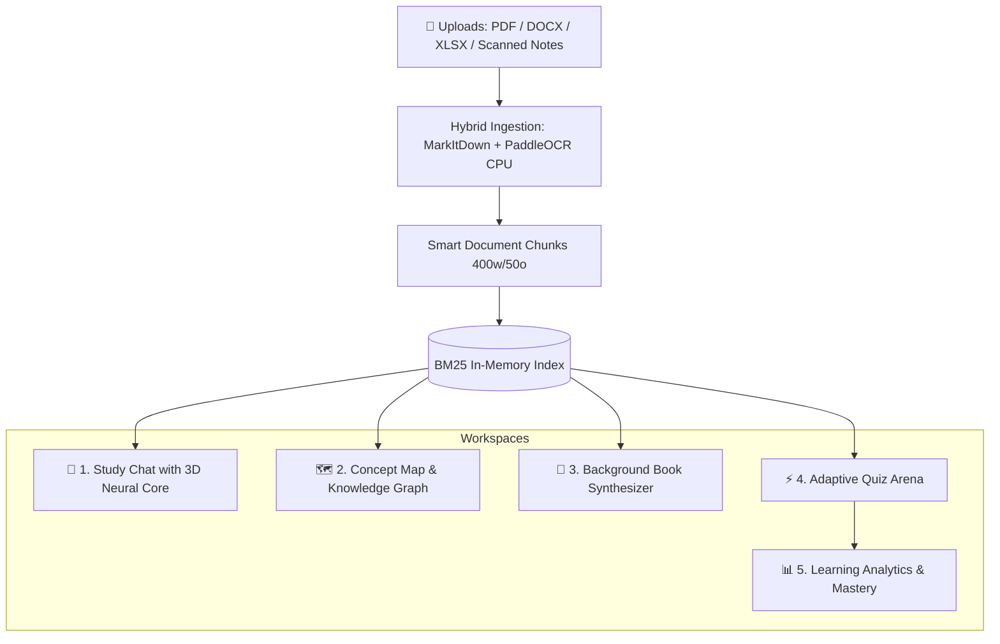

# 🧠 BUDDY — Autonomous Local AI Study Platform

<div align="center">


<p align="center">
  <strong>100% Local • Zero Cloud Subscriptions • Zero Data Leakage • Single-Origin Zero-CORS</strong>
</p>
<p align="center">
  An all-in-one local AI learning companion featuring <strong>Multi-Stage RAG Chat</strong> with a <strong>3D GLSL Neural Core</strong>, <strong>Physics-Driven Concept Knowledge Graphs</strong>, <strong>Autonomous Background Textbook Generator</strong>, <strong>Adaptive Quiz Arena</strong>, and <strong>Deep Learning Analytics</strong>.
</p>

</div>

---

## ⚡ The Elevator Pitch: Why BUDDY?

Modern AI study tools (Notion AI, Quizlet, Chegg) suffer from three fatal flaws:
1. **Expensive Subscriptions**: Trapped behind steep monthly SaaS paywalls.
2. **Privacy Vulnerabilities**: Student notes, proprietary research, and academic slides are uploaded to public cloud LLMs.
3. **Hardware Fragility**: Most local LLM solutions crash with Out-Of-Memory (OOM) errors on consumer laptops.

**BUDDY changes the paradigm.** Engineered from the ground up for consumer hardware (tested on an **NVIDIA RTX 3050 6GB Laptop GPU**), BUDDY orchestrates **Ollama (`gemma4:e4b`)**, **CPU-bound BM25 retrieval**, **SQLite WAL concurrency**, and a **custom Priority GPU Lock Manager** to deliver an enterprise-grade AI study copilot that runs **100% offline, private, and lightning fast**.

---

## 🏛️ System Architecture

BUDDY runs as a **single-origin server on Port 8000**, serving both the high-performance FastAPI REST/SSE endpoints and the Obsidian Cyber-Glass frontend without CORS overhead.

```
╔══════════════════════════════════════════════════════════════════════════════╗
║                          BUDDY SYSTEM ARCHITECTURE                           ║
╠══════════════════════════════════════════════════════════════════════════════╣
║                                                                              ║
║  ┌───────────────────────────────┐     ┌──────────────────────────────────┐  ║
║  │   FRONTEND (Obsidian Cyber)   │     │        BACKEND (FastAPI)         │  ║
║  │                               │     │                                  │  ║
║  │  ┌─────────────────────────┐  │     │  ┌────────────────────────────┐  │  ║
║  │  │ Three.js Neural Core    │  │◄───►│  │ Ollama (gemma4:e4b)        │  │  ║
║  │  │ Procedural GLSL Shaders │  │ SSE │  │ 5.8GB VRAM Resident        │  │  ║
║  │  └─────────────────────────┘  │     │  └────────────────────────────┘  │  ║
║  │  ┌─────────────────────────┐  │     │  ┌────────────────────────────┐  │  ║
║  │  │ Force-Directed Concept  │  │     │  │ BM25 Retrieval Engine      │  │  ║
║  │  │ Knowledge Graph Physics │  │     │  │ rank_bm25 (<5ms CPU sweep) │  │  ║
║  │  └─────────────────────────┘  │     │  └────────────────────────────┘  │  ║
║  │  ┌─────────────────────────┐  │     │  ┌────────────────────────────┐  │  ║
║  │  │ Adaptive Quiz Arena     │  │     │  │ MarkItDown + PaddleOCR     │  │  ║
║  │  │ Dynamic Particles & FX  │  │     │  │ Hybrid Ingestion (0 VRAM)  │  │  ║
║  │  └─────────────────────────┘  │     │  └────────────────────────────┘  │  ║
║  │  ┌─────────────────────────┐  │     │  ┌────────────────────────────┐  │  ║
║  │  │ SVG/Canvas Analytics    │  │     │  │ SQLite WAL + Dual Priority │  │  ║
║  │  │ Retention & Mastery     │  │     │  │ GPU Lock Manager           │  │  ║
║  │  └─────────────────────────┘  │     │  └────────────────────────────┘  │  ║
║  └───────────────────────────────┘     └──────────────────────────────────┘  ║
║                     Port 8000 (Single Origin — Zero CORS)                    ║
╚══════════════════════════════════════════════════════════════════════════════╝
```

---

## 🎯 5 Integrated Workspaces



### 1. 🧠 Study Chat & 4-Stage Paced Thinking
- **Interactive 3D Neural Core**: Procedural WebGL/GLSL shader pulsing in real-time response to AI thought states (`idle`, `searching`, `synthesizing`, `streaming`).
- **4-Stage Paced RAG Thinking**:
  - `[Stage 1/4] Query Decomposition`: Deconstructs ambiguous student queries into precise semantic vectors.
  - `[Stage 2/4] BM25 Lexical Sweep`: Sub-5 millisecond CPU scan over tokenized document chunks.
  - `[Stage 3/4] Cross-Attention Reranking`: Prunes top 10 retrieved chunks down to the 4 most mathematically salient passages.
  - `[Stage 4/4] Self-Verification & Citation`: Streams verified answers with exact citation references over Server-Sent Events (SSE).

### 2. 🗺️ Concept Map & Physics Knowledge Graph
- Dynamic force-directed canvas layout with collision detection, spring dynamics, and draggable nodes.
- Automatic semantic clustering: Core Themes, Chapters, Sub-Concepts, and Mathematical Formulas.
- One-click **Master Cheat Sheet** generation synthesized straight from document clusters.

### 3. 📖 Autonomous Textbook Synthesizer
- Generates comprehensive, multi-chapter textbooks (5 to 8 chapters) from uploaded course notes.
- **Priority-Yielding Worker**: Runs autonomously in the background. If a student initiates a chat question or quiz, the Book Worker automatically yields GPU access, resuming once the interactive request completes.

### 4. ⚡ Adaptive Quiz Arena
- Auto-generates structured MCQs calibrated across multiple cognitive difficulty tiers.
- Real-time AI grading with dynamic particle explosion visual feedback.
- Automated **Remediation Engine**: Pinpoints weaknesses and prescribes focused study paths.

### 5. 📊 Deep Learning Analytics
- Procedural SVG accuracy gauge rings.
- Bezier trajectory charts tracking score velocity across attempts.
- Topic mastery progress bars calculating cognitive retention over time.

---

## 🔬 The 6GB VRAM Engineering Breakthrough

Running advanced RAG and multi-agent workflows on a laptop GPU (NVIDIA RTX 3050 6GB) usually triggers cuda out-of-memory errors. BUDDY solves this with strict resource partition engineering:

| Component | VRAM Allocation | Host Resource | Optimization Technique |
|-----------|-----------------|---------------|------------------------|
| **Ollama (`gemma4:e4b`)** | **~5.8 GB** | GPU (VRAM) | `keep_alive=-1` prevents eviction latency |
| **BM25 Retrieval** | **0 MB** | CPU RAM | Fast in-memory token matrices (<5ms latency) |
| **PaddleOCR Ingestion** | **0 MB** | CPU RAM | Hardcoded `CUDA_VISIBLE_DEVICES=""` |
| **PyMuPDF / MarkItDown** | **0 MB** | CPU RAM | Multithreaded text extraction |
| **Database & Cache** | **0 MB** | Disk / RAM | SQLite with Write-Ahead Logging (`WAL`) |
| **Total VRAM Consumption** | **~5.8 GB** | — | **Guaranteed under 6GB VRAM ceiling** |

### 🔒 Dual-Priority GPU Scheduler

```
┌──────────────────────────────────────────────────────────┐
│  HIGH PRIORITY (Interactive Latency-Sensitive Tasks)     │
│  Chat Q&A  •  Instant Quiz  •  Concept Map Extraction    │
└────────────────────────────┬─────────────────────────────┘
                             │ Preempts / Yields
┌────────────────────────────▼─────────────────────────────┐
│  LOW PRIORITY (Background Workloads)                     │
│  Full-Book Chapter Synthesis  •  Document Summarization  │
└──────────────────────────────────────────────────────────┘
```

---

## 🚀 Quickstart for Judges

### 1. Prerequisites
- **Python**: 3.10 or higher
- **Ollama**: Installed and running ([ollama.com](https://ollama.ai))
- **Model**: `ollama pull gemma4:e4b`

### 2. Clone & Install

```bash
git clone https://github.com/harshverse-svg/buddy-ai-study-platform.git
cd buddy-ai-study-platform

# Install Python requirements
pip install -r requirements.txt
```

### 3. Launch BUDDY

**Option A (1-Click Launcher):**
- **Windows**: Double-click `run.bat`
- **Linux / macOS**: Execute `./run.sh`

**Option B (Manual Terminal):**
```bash
python backend/main.py
```

Visit **`http://localhost:8000`** in your browser.

> [!NOTE]
> **Automated Judge Demo Data**: On first startup, BUDDY automatically detects an empty database and seeds a complete **Machine Learning Fundamentals** study session (with pre-built concept maps, documents, and quizzes). Judges can test every workspace immediately without needing to upload files first!

---

## 📂 Project Structure

```
buddy-ai-study-platform/
├── backend/
│   ├── config.py              # Central environment, VRAM, and path settings
│   ├── models.py              # SQLAlchemy ORM schema (6 relational tables)
│   ├── database.py            # SQLite WAL mode, thread-safe session factory & demo seed
│   ├── ingestion.py           # Hybrid MarkItDown + PaddleOCR pipeline
│   ├── ai_engine.py           # Priority GPU lock, BM25 sweep, quiz & book engines
│   ├── summary_engine.py      # Map-reduce document summarizer & blurb generator
│   ├── main.py                # FastAPI routes (REST + SSE) and static mount
│   ├── requirements.txt       # Backend dependencies
│   └── storage/
│       ├── markdown/          # Processed document chunks & demo content
│       └── uploads/           # Original uploaded documents
├── frontend/
│   ├── index.html             # High-performance SPA with 5 reactive workspaces
│   ├── css/
│   │   └── style.css          # Obsidian Cyber-Glass design system
│   ├── js/
│   │   ├── app.js             # Main application state and API controller
│   │   ├── procedural_three.js# Three.js WebGL Neural Core shader
│   │   ├── procedural_graph.js# Force-directed physics concept map
│   │   ├── procedural_charts.js# SVG/Canvas analytics and retention rings
│   │   ├── hero.js            # Interactive landing and camera controls
│   │   └── transitions.js     # Workspace transition animations
│   └── static/
│       └── video/             # Holographic visual assets
├── .env.example               # Configurable environment parameters
├── .gitignore                 # Production-grade git exclusion rules
├── CONTRIBUTING.md            # Community contribution guide
├── LICENSE                    # MIT License
├── README.md                  # System overview and architectural specs
├── requirements.txt           # Root dependency manifest
├── run.bat                    # Windows 1-click launcher
└── run.sh                     # Unix/macOS launcher
```

---

## 📑 Supported Document Types

| Format | Parsing Engine | Ingestion Mode | Speed |
|--------|----------------|----------------|-------|
| `.pdf` (Digital) | PyMuPDF | Direct text extraction | Instant (< 0.2s) |
| `.pdf` (Scanned) | PaddleOCR (CPU) | Deep text-line detection | 2–4s / page |
| `.docx` | MarkItDown | Structured markdown conversion | Instant (< 0.3s) |
| `.xlsx` / `.csv` | MarkItDown + Pandas | Tabular markdown serialization | Instant (< 0.1s) |
| `.md` / `.txt` | Native I/O | Direct stream parsing | Instant |
| `.png` / `.jpg` | PaddleOCR (CPU) | High-precision visual OCR | 1–3s / image |

---

## 🎨 Visual Design: Obsidian Cyber-Glass

BUDDY features a custom-crafted design system inspired by futuristic developer tooling:
- **Obsidian Void Foundation**: Deep dark backgrounds (`#05070B`) minimizing eye strain during late-night study sessions.
- **Liquid Glass Aesthetic**: Translucent glass panels with `backdrop-filter: blur(28px)`.
- **Tri-Accent Color Palette**: Electric Cyan (`#00F0FF`), Hyper-Violet (`#8A2BE2`), and Neon Emerald (`#00FF88`).
- **Interactive Micro-Gestures**: 3D card tilt physics, animated specular border gleams, and interactive particle cascades.

---

## 🔌 API Documentation

FastAPI provides an interactive OpenAPI (Swagger) interface accessible at **`http://localhost:8000/docs`**.

| Endpoint | Method | Description |
|----------|--------|-------------|
| `/api/sessions` | `GET` / `POST` | List all study sessions or initialize a new workspace |
| `/api/upload` | `POST` | Upload documents for hybrid ingestion & chunking |
| `/api/chat/stream` | `POST` (SSE) | Stream multi-stage RAG thinking and answers |
| `/api/concept-map` | `GET` / `POST` | Generate or fetch force-directed knowledge graph |
| `/api/quiz/generate`| `POST` | Generate adaptive MCQs for current study session |
| `/api/quiz/grade` | `POST` | Grade quiz submission and deliver remediation advice |
| `/api/book/generate`| `POST` | Trigger background multi-chapter textbook synthesis |
| `/api/book/stream` | `GET` (SSE) | Stream book chapter synthesis progress |
| `/api/analytics` | `GET` | Fetch topic mastery, quiz accuracy, and study metrics |

---

## 🛣️ Roadmap

- [x] Local RAG with BM25 Lexical Sweep & Cross-Attention Reranking
- [x] Dual-Priority GPU Scheduler for 6GB VRAM GPUs
- [x] Interactive 3D WebGL Neural Core Visualization
- [x] Force-Directed Concept Knowledge Graph with Cheat Sheet Export
- [x] Autonomous Multi-Chapter Textbook Synthesizer
- [ ] Multimodal Voice-to-Voice Real-Time Audio Tutor
- [ ] Bi-directional Spaced Repetition (Anki Flashcard Sync)
- [ ] Collaborative Peer-to-Peer Local Network Study Sessions

---

## 👤 Author & Acknowledgments

- **Creator**: [Harsh Maurya](https://github.com/harshverse-svg)
- **Built for**: Hackathon Excellence & Open-Source AI Education
- **Model**: Gemma by Google DeepMind (served via Ollama)

---

## 📜 License

This project is licensed under the [MIT License](LICENSE) — free for academic, personal, and commercial innovation.
